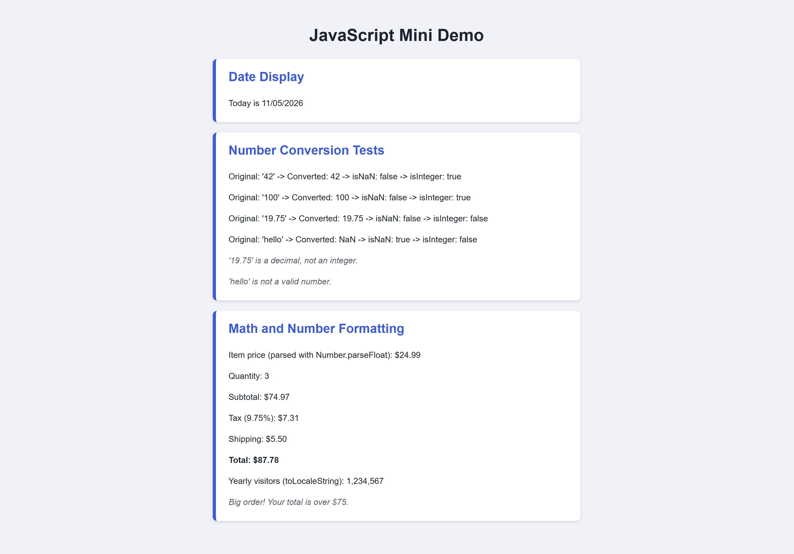

# HW9: JavaScript Mini Demo

CIT 384, Homework 9 (JavaScript Built-In Objects)

## GitHub Pages Link

[https://YOUR-GITHUB-USERNAME.github.io/YOUR-REPO-NAME/](https://github.com/psynat3/JavaScript-Built-In)

## Screenshot

JavaScript.jpeg

## Built-In Objects and Methods Used

**Date object**
- `new Date()`
- `getMonth()`
- `getDate()`
- `getFullYear()`

**Number object**
- `Number()`
- `Number.isNaN()`
- `Number.isInteger()`
- `Number.parseFloat()`
- `toFixed()`
- `toLocaleString()`

**Other**
- `String()` and `padStart()` for the two digit month and day
- `document.getElementById()`, `textContent`, and `innerHTML` to show results on the page
- `if/else` statements and comparison operators (`>`)

## Extra Credit

I added light CSS styling in `style.css` so each section looks like its own card.

## Reflection

The easiest part was the math section because the price calculator is just basic arithmetic. The hardest part was the date, since I had to remember that `getMonth()` starts at 0 and that the month and day need a leading zero. I learned that the `Date` object gives you the pieces separately, so you have to build the MM/DD/YYYY string yourself. I also learned that `Number()` turns bad input like "hello" into `NaN` instead of crashing, and `Number.isNaN()` and `Number.isInteger()` let you check what you got. Showing results in the browser was easier than I expected once I used `getElementById()` with `innerHTML`.
